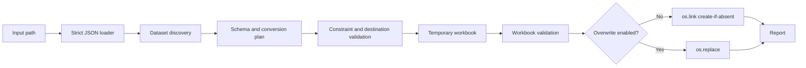

# jxcel Product and Implementation Roadmap

## Status and decision vocabulary

This roadmap specifies the approved V1 target. The repository contains the package foundation and completed Phase 2 JSON loading/validation, but the overall converter is not implemented. Status labels are **Confirmed**, **Approved**, **Proposed**, **Deferred**, and **Open**. Confirmed requirements come directly from the product request. Approved decisions have explicit user approval. Proposed items are not settled. Deferred items are outside V1. Open items need a decision before dependent implementation.

## 1. Product overview

### Vision and users

`jxcel` is a cross-platform command-line tool for turning JSON files with tabular datasets into professionally formatted `.xlsx` workbooks. It is for people who need to inspect or share JSON data in Excel without writing a one-off exporter or predefining columns. Expected data may describe any domain; there must be no student-specific or fixed-schema assumptions.

### Problem and use cases

Users should be able to point the installed command at a JSON file, inspect discovered datasets, optionally select datasets or columns, preview or plan the export, and create a workbook with one worksheet per exportable selected dataset.

### Platforms and V1 objectives

Linux, Windows, and macOS are intended targets. V1 must provide an installable Python CLI command named `jxcel`, strict JSON handling, deterministic discovery, predictable schema and value handling, a formatted workbook, safe output publication, useful reporting, and documented platform verification. Intended compatibility is not proof of actual testing; record test evidence per platform.

### Non-goals

V1 is not a GUI, database, domain-specific report generator, JSONL processor, streaming parser, constant-memory converter, batch/parallel system, plugin host, or general-purpose schema mapping framework. Automatic nested-array expansion, CSV output, configuration files, and worksheet splitting are also deferred.

## 2. Functional specification

### 2.1 Input and JSON validation

The command accepts exactly one input source: positional `INPUT` or `-i/--input INPUT`. Paths may be relative or absolute. Read UTF-8 and accept a UTF-8 BOM. Reject invalid UTF-8, empty or invalid JSON, duplicate object keys, and non-standard numeric constants (`NaN`, `Infinity`, `-Infinity`). Report the input path and useful line/column information when available. The loader accepts every JSON root category, including primitives, subject to its supported numeric representation: integer tokens use Python's normal integer conversion and decode as Python `int`; the active Python integer-string conversion limit is respected. An integer token exceeding that configured limit fails with a path-aware integer-conversion error. jxcel does not modify the interpreter-wide limit or disable its protection. Real-number tokens must decode as finite Python `float`. Reject a real-number token that overflows to a non-finite float or underflows a nonzero value to zero as an **unsupported numeric range**, not malformed JSON. Include the input path and original token, without promising a source line or column for this hook-level error. Accept zero-valued exponent forms such as `0e999` and `-0e999`. This explicit numeric range limit is allowed by JSON's interoperability guidance; it prevents silent conversion to infinity or zero. Excel-specific limits are checked later during planning/export. A primitive root is not a parse error: discovery reports it as an `unsupported_root` finding at JSON Pointer `""`. `--list` and `--dry-run` expose the finding. Conversion reports a clear failure if no exportable dataset exists. Root arrays and objects follow discovery rules below.

The initial loader may use `json.load()` and therefore loads the complete document into memory. Do not claim streaming support. Resource limits for very large input files are Open; memory exhaustion must not be described as gracefully bounded unless implemented and tested.

### 2.2 Dataset discovery and findings

Traverse depth-first, pre-order from JSON Pointer `""`. Visit object values in the JSON source's key order and array elements by ascending index. Preserve this order in findings and dataset listing.

Classify each array exactly once using this precedence:

1. Empty array → `empty_array`.
2. Nonempty array where every direct element is an object → `dataset`.
3. Array with at least one direct object and at least one other type → `mixed_array`.
4. Array containing nested arrays but no direct objects → `nested_array`.
5. Remaining primitive-only array → `primitive_array`.

For a dataset, record one dataset finding and stop traversal at its boundary. Do not report nested arrays in dataset records as separate datasets or unsupported structures; nested arrays in cells are serialized as JSON text. For an unsupported array, record one finding at that array's pointer and continue through its object and array elements, so independent nested datasets can still be discovered. The unsupported parent and its nested dataset findings are intentionally both reported. No pointer receives multiple findings for the same structure.

A root object is a container to traverse. A root array of objects is a dataset at pointer `""`. A primitive root produces one `unsupported_root` finding at pointer `""`; it is valid JSON, not a parsing failure. `--list` and `--dry-run` expose this finding, and conversion fails clearly if there is no exportable dataset. Empty arrays and primitive-only arrays are never datasets. Arrays of arrays are classified as `nested_array` unless an earlier precedence rule applies; traversal can discover eligible datasets inside nested array elements.

Every valid all-object array is a discovered dataset candidate, including arrays whose records are all empty objects. If planning yields zero columns, mark that dataset finding non-exportable and give the reason. Do not invent a synthetic column or create an empty worksheet.

### 2.3 Canonical identifiers

Use JSON Pointer as the canonical dataset identifier. Escape each key segment with `~` → `~0`, then `/` → `~1`. The root pointer is the empty string. Do not use dotted paths as canonical dataset IDs. The exact pointer is used by `--dataset` and by each JSON-pair column mapping.

### 2.4 Schema and nested values

The schema is the union of properties across all records. Order columns by first occurrence as records are traversed, and within each record by original object key order. Missing properties and explicit `null` both produce blank cells. Do not silently overwrite fields or values.

Nested objects flatten by default using the jxcel-specific scheme below. With `--no-flatten`, each top-level property in a dataset record is one column. A nested object is serialized as compact JSON text in the cell for its parent property; its child properties never become columns. No partial or recursive flattening occurs. Empty nested objects serialize as `{}`. Nested arrays serialize as compact JSON text. Missing properties and explicit `null` values continue to produce blank cells. Do not expand nested arrays into rows or worksheets.

For example, given `[{"id":1,"user":{"name":"Ada"},"tags":["math","art"],"extra":{}}]`, `--no-flatten` produces columns `id`, `user`, `tags`, `extra`. Representative cells are `1`, `{"name":"Ada"}`, `["math","art"]`, and `{}`. In this mode, column mappings refer to these planned top-level names. Without `--no-flatten`, nested object properties follow the flattened-column rules below, and column mappings use the resulting flattened names.

#### Flattened-column encoding

Encode each key segment with a single left-to-right pass: `~` → `~0`; `.` → `~1`. Join encoded segments with literal `.`. This is **not JSON Pointer**.

Example: literal key `user.name` becomes `user~1name`; nested keys `user` then `name` become `user.name`. Decode by splitting on literal dots first, then scanning each segment once from left to right, converting `~0` to `~` and `~1` to `.`. Never recursively decode replacements. The encoding must round-trip keys containing literal dots, tildes, `~0`, `~1`, and Unicode. If duplicate flattened column names occur, fail planning and report the conflicting source paths; never overwrite a field.

### 2.5 Column selection

`--column-map JSON_PAIR` and `--exclude-map JSON_PAIR` are repeatable. Each argument must be valid JSON representing an array of exactly two strings: canonical dataset JSON Pointer and exact planned column name. With normal flattening this is the flattened name; with `--no-flatten` it is the top-level property name. This representation supports commas, equals signs, quotes, punctuation, and Unicode without custom delimiter escaping.

Validate every include and exclude mapping against **all discovered dataset candidates and their available planned schemas for the active flattening mode**, independently of `--dataset`. A valid mapping for a discovered dataset is not rejected merely because that dataset is unselected. Apply mappings only to datasets selected for the current operation. In `--dry-run`, identify valid mappings targeting unselected datasets as validated but unapplied because of dataset selection. Unknown dataset pointers and unknown column names remain clear errors. A zero-column/non-exportable dataset remains non-exportable; mappings cannot invent columns or make it exportable.

After global validation, compute effective columns for each selected, exportable dataset:

1. If no inclusion map exists for it, start with all planned columns.
2. If inclusion mappings exist, start with only those mapped columns.
3. Apply exclusions afterward; exclusions take precedence.

Reject malformed pairs, unknown pointers, and unknown columns during global validation. Repeated identical mappings are idempotent; a column present in both include and exclude mappings is valid and excluded because exclusions take precedence.

Mappings apply independently across datasets. The CLI uses shell-specific quoting; examples appear in Section 3.

### 2.6 Data preservation

Preserve strings as strings; do not reinterpret date-like or numeric-looking strings. Preserve booleans, safe integers and floating-point values, blanks for null/missing, and Unicode including Arabic. Integers exceeding Excel's reliable 15-digit precision must be written as text with a warning. Nested arrays/objects represented as JSON text must use deterministic compact JSON serialization. Any transformation or precision-preservation choice must be reported. Invalid numeric values are rejected during loading.

Formula-like strings must remain text and must never become formulas. Implement and test a safe value-writing policy without altering the visible source text unnecessarily. If Excel cannot represent a value within its limits, fail clearly; do not truncate or silently omit it.

### 2.7 Reporting

Report exported datasets, non-exportable dataset candidates, unsupported structures, warnings, data-preservation decisions, output path, and validation results. `--quiet` may reduce routine success output but must not suppress errors or important data-loss warnings.

Unsupported-structure findings remain visible even if the user selects only certain datasets.

## 3. CLI specification

The following describes planned behavior; it is not implemented in the current bootstrap. Exactly one input source is required. A valid primitive JSON root is accepted by the loader but reported by discovery as `unsupported_root` at pointer `""`; list and dry-run expose it, and conversion fails clearly if there is no exportable dataset.

| Option | Type/default | Behavior and validation |
|---|---|---|
| `INPUT` | Path; absent by default | Positional input. Mutually exclusive with `-i/--input`; exactly one source required. |
| `-i, --input PATH` | Path; absent by default | Alternative explicit input source. Mutually exclusive with positional input. |
| `-o, --output PATH` | Path; default is input basename with `.xlsx` beside input | Select output destination. The parent directory must already exist and be a directory. Fail clearly otherwise; do not create it or place the temporary file elsewhere. This applies to custom paths and overwrite mode. |
| `--overwrite` | Boolean; false | Permit replacement only through the validated `os.replace` publication path. Without it, existing destination is an error. |
| `-d, --dataset JSON_POINTER` | Repeatable; all discovered datasets by default | Select datasets by canonical pointer. Reject unknown pointers. |
| `--list` | Boolean | Parse and discover; list dataset pointers, counts, available columns, and unsupported findings. No workbook. |
| `--column-map JSON_PAIR` | Repeatable; none | Include exact columns per dataset using JSON pair syntax. |
| `--exclude-map JSON_PAIR` | Repeatable; none | Exclude exact columns per dataset after inclusion mapping. Exclusion wins. |
| `--preview` | Boolean | Display bounded records, respecting dataset/column selection. No workbook. |
| `--preview-rows N` | Positive integer; default must be selected/documented during CLI phase | Set preview sample bound. Reject zero/negative values. |
| `--dry-run` | Boolean | Show complete plan without creating XLSX: selected datasets, effective columns, destination, unsupported findings, and warnings. |
| `--no-flatten` | Boolean | Use one column per top-level property; serialize nested objects in the parent column as compact JSON text. No child-property columns or partial flattening. Empty objects serialize as `{}`; nested arrays remain compact JSON text. |
| `-v, --verbose` | Boolean | Add diagnostic detail without suppressing normal errors. |
| `-q, --quiet` | Boolean | Reduce routine success output; errors and important unsupported-data warnings remain visible. Interaction with `--verbose` must be rejected or resolved explicitly during CLI implementation. |
| `--version` | Flag | Display installed package version. |
| `-h, --help` | Flag | Display argument help. |

`--preview` and `--dry-run` may be combined; clearly label the preview within the plan. Reject `--list` combined with either `--preview` or `--dry-run`. Dataset selection filters dataset rows and preview/plan content. Column mappings are validated against all discovered dataset candidates regardless of selection, but applied only to selected datasets. In `--dry-run`, mappings for valid but unselected datasets are listed as validated and unapplied because of dataset selection. Column maps affect the effective columns in list/plan and preview projection for selected datasets, while list also retains each selected dataset's complete available schema. Unsupported findings remain visible in all modes, including `--list` and `--dry-run`; these modes expose an `unsupported_root` finding for a primitive root. Conversion fails clearly when there is no exportable dataset.

JSON-pair examples:

**Bash**

```bash
jxcel data.json \
  --column-map '["/students","user.name"]' \
  --column-map '["/orders","order,id"]' \
  --exclude-map '["/orders","internal=status"]'
```

**PowerShell**

```powershell
jxcel data.json `
  --column-map '["/students","user.name"]' `
  --column-map '["/orders","order,id"]' `
  --exclude-map '["/orders","internal=status"]'
```

**Windows CMD**

```bat
jxcel data.json --column-map "[\"/students\",\"user.name\"]" --column-map "[\"/orders\",\"order,id\"]" --exclude-map "[\"/orders\",\"internal=status\"]"
```

Examples use simple ASCII pointers and names; JSON string values may contain Unicode and punctuation. Verify shell argument behavior on Windows before claiming the example works across all shells.

Planned usage examples:

```text
jxcel data.json
jxcel -i /path/to/data.json -o /path/to/result.xlsx
jxcel data.json --list
jxcel data.json --dataset /students --preview --preview-rows 5
jxcel data.json --dataset /students --dry-run
jxcel data.json --dataset /students --column-map '["/students","id"]'
jxcel data.json --overwrite
```

## 4. Architecture specification

### Structure and module ownership

```text
src/jxcel/
├── __init__.py
├── cli.py
├── jsonio.py
├── discovery.py
├── planning.py
├── workbook.py
└── reporting.py
```

Only create modules as their phase begins. `__init__.py` remains minimal. `cli.py` coordinates the pipeline. `jsonio.py` reads and validates JSON. `discovery.py` classifies arrays and reports paths. `planning.py` determines schemas, flattening, selections, conversions, and constraints. `workbook.py` writes, formats, validates, and publishes. `reporting.py` renders findings and results. Use small pure functions for transformation/discovery logic where suitable; avoid unnecessary classes.

### Pipeline



Core internal concepts should be represented by simple data structures only where useful: dataset candidate (pointer, records, schema/status), structure finding (pointer, kind, reason), conversion plan (input/output, datasets/effective columns, warnings), and result/report. Do not create a class for every concept.

Errors should be raised at the responsible boundary with context and translated to readable messages and nonzero exit status at the CLI boundary. Reporting formats results; it does not discover or transform data.

## 5. Discovery examples and ordering

For `{"a":[{"x":1}],"b":[1,{"nested":[{"y":2}]}]}`, traversal first finds dataset `/a`, then a `mixed_array` at `/b`, then nested dataset `/b/1/nested`. No descendants are found under `/a`. The order is exactly that pre-order walk.

For `[{},{}]`, discover dataset at `""`; after planning, mark it non-exportable because the union schema has zero columns. For `[]`, report `empty_array` at `""`. For `[1,2]`, report `primitive_array`. For `[[{"x":1}]]`, report `nested_array` at `""`, then discover dataset `/0`. An object root itself is only a container. A primitive root is valid JSON and produces one `unsupported_root` finding at `""`; list and dry-run expose it, while conversion fails clearly if no exportable dataset exists.

JSON Pointer escaping: a property key `a/b~c` is addressed as `/a~1b~0c`. Preserve source array order and object key order, not sorted order.

## 6. Workbook and Excel constraints

Create one worksheet per exportable selected dataset. Sanitize names to Excel's worksheet naming rules and resolve collisions deterministically (for example with stable numeric suffixes); preserve mapping from dataset pointer to final sheet name in the plan/report. Use formatted headers, freeze the header row, auto filters, and bounded width calculation. Use normal openpyxl workbook mode initially. Do not introduce write-only mode absent measured performance evidence.

Before writing, enforce Excel worksheet limits: 1,048,576 rows including the header, 16,384 columns, and 32,767 characters per cell. Excel numeric precision is 15 digits. Reject oversized data clearly; do not truncate, drop columns, or split across sheets. Formula-like values must be emitted as text. Validate the saved temporary workbook before publication.

## 7. Safe output publication

Resolve input/output path collision before creating a temporary file. The output parent directory must already exist and be a directory. If it does not exist or is not a directory, fail clearly. Do not create parent directories, and do not place a temporary file elsewhere as a workaround. Apply this rule to default and custom output paths and in overwrite mode. Always write a uniquely named temporary file in the output directory, close it, and validate it first.

### Without `--overwrite`

Publish with `os.link(temp_path, output_path)`. This is the create-if-absent path: if output already exists, including if another process created it during conversion, fail without replacing it. On success, remove the temporary name. If hard-link creation is unsupported or denied, fail clearly; never fall back to a replace-capable method. Clean temporary names on failure when possible.

### With `--overwrite`

Keep any existing destination untouched while building and validating the temporary file. Then call `os.replace(temp_path, output_path)`. Never delete the old destination before this call. Report a failed replacement accurately and clean up the temporary file when possible. Same-directory temporary files avoid a cross-filesystem move. Atomicity and failure behavior depend on OS/filesystem; do not promise stronger guarantees than documented and tested. An open/locked destination or permissions may prevent replacement on some platforms.

## 8. Implementation phases

Each phase requires explicit user authorization. Completion of a phase does not authorize the next phase.

### Phase 1 — Project Foundation and Packaging

1. **Objective:** establish package metadata, bootstrap command, repository instructions, and specification.
2. **Scope:** `pyproject.toml`, package structure, docs, minimal nonfunctional CLI placeholder.
3. **Non-goals:** parsing, discovery, workbook generation, real CLI behavior.
4. **Prerequisites:** this approved foundation specification.
5. **Tasks:** implement package metadata and entry point; add minimal package version surface; make placeholder return a clear not-implemented message and nonzero status; keep docs aligned.
6. **Expected files:** `pyproject.toml`, `src/jxcel/__init__.py`, `src/jxcel/cli.py`, `AGENTS.md`, `ROADMAP.md`, `README.md`, `.gitignore`.
7. **Tests:** metadata TOML parse, package/entry target consistency, placeholder message/status if substantive tests are added.
8. **Acceptance:** declared command target exists; invoking it never pretends conversion works; metadata runtime dependencies include only openpyxl; docs say not functional.
9. **Failure conditions:** broken entry point, undocumented behavior, conversion logic, or altered legacy exporter.
10. **Evidence:** list files, metadata checks, placeholder behavior check.
11. **Later dependencies:** all implementation phases rely on this structure.

### Phase 2 — JSON Loading and Validation

**Status: COMPLETED and approved by the user.** The implementation passed focused and full test discovery (25 tests); independent QA passed. The loader respects Python's active integer-string conversion limit without changing it and reports over-limit integer tokens as a distinct path-aware error.

1. **Objective:** parse JSON strictly with useful errors.
2. **Scope:** UTF-8/BOM, malformed input, duplicate keys, nonstandard constants, supported numeric range, root value handoff.
3. **Non-goals:** discovery, Excel, streaming.
4. **Prerequisites:** Phase 1.
5. **Tasks:** implement `jsonio.py`; reject duplicates via object-pair handling; reject NaN/Infinity; reject real-number overflow and nonzero-to-zero underflow as unsupported numeric range; include path and original numeric token for range errors and parser location where available; define invalid encoding and empty-file errors.
6. **Expected files:** `jsonio.py`, focused tests, roadmap updates if behavior changes.
7. **Tests:** valid UTF-8/BOM and Unicode; invalid UTF-8/JSON; empty and whitespace-only files; duplicate keys at root, nested levels, and objects in arrays; NaN/Infinity; all JSON root categories and native value types; normal integers/decimals; integer-token acceptance at and rejection beyond the active Python integer-string conversion limit when enabled; `1e308`, `1e309`, `1e999`, negative overflow, `1e-324`, `1e-325`, negative underflow, `1e-320`, `0e999`, and `-0e999`; path-aware syntax, encoding, integer-conversion, numeric-range, and I/O errors.
8. **Acceptance:** supported JSON values load without partial data; malformed data, duplicate keys, nonstandard constants, and unsupported numeric ranges fail clearly without silent acceptance or numeric corruption.
9. **Failure conditions:** duplicate overwrite, permissive nonstandard values, silent float overflow/underflow, misclassifying unsupported numeric range as malformed JSON, or claim of streaming.
10. **Evidence:** targeted unittest results and examples of error context.
11. **Later dependencies:** discovery consumes only successfully parsed JSON.

### Phase 3 — Dataset Discovery

**Status: NOT STARTED.** The next authorized activity is read-only Phase 3 analysis; implementation requires explicit user approval.

1. **Objective:** discover dataset candidates and unsupported structures deterministically.
2. **Scope:** pointer traversal, classification, boundary, findings.
3. **Non-goals:** schema flattening and workbook output.
4. **Prerequisites:** Phase 2.
5. **Tasks:** implement ordered pre-order traversal; exact array precedence; nested exploration of unsupported arrays; root handling; pointer escaping; single finding per pointer.
6. **Expected files:** `discovery.py`, discovery tests.
7. **Tests:** every class and precedence, root object/array/primitive, mixed array containing nested dataset, nested-array dataset, empty arrays, empty objects, dataset boundary, traversal ordering, `~` and `/` pointer escapes.
8. **Acceptance:** output findings and paths match specification exactly and repeatably.
9. **Failure conditions:** traversal into dataset records, dropped unsupported arrays, duplicate findings.
10. **Evidence:** test output and representative discovery report.
11. **Later dependencies:** planning consumes discovered candidate pointers and records.

### Phase 4 — Schema Planning and Transformation

1. **Objective:** determine deterministic columns and safe cell values.
2. **Scope:** schema union/order, flattening, column maps, serialization, constraints.
3. **Non-goals:** workbook writing.
4. **Prerequisites:** Phase 3.
5. **Tasks:** union columns in first-seen order; implement exact reversible key-segment encoding/decoding; fail collisions; handle no-flatten, arrays/empty objects, null/missing, big integers, formulas; parse JSON-pair maps and compute effective columns; check worksheet/cell limits.
6. **Expected files:** `planning.py`, planning tests.
7. **Tests:** schema unions/order, null/missing, collision/round trips for dots/tildes/`~0`/`~1`/Unicode, nested apparent paths, selection/exclusion precedence, punctuation/Unicode pairs, unknown references, large integers, formula-like strings, limits, and validation of mappings for discovered-but-unselected candidates while applying them only to selected datasets. Test that dry-run labels such mappings validated but unapplied.
8. **Acceptance:** deterministic plan with no overwritten fields, implicit type inference, or silent truncation.
9. **Failure conditions:** ambiguous column names, silent collisions, discarded values, or undocumented coercion.
10. **Evidence:** targeted tests and sample plan.
11. **Later dependencies:** workbook and CLI phases consume the plan.

### Phase 5 — Excel Workbook Generation

1. **Objective:** create and validate formatted XLSX content from a valid plan.
2. **Scope:** deterministic sheets, formatting, values, temporary file, validation, publication helpers.
3. **Non-goals:** full CLI option orchestration or platform release claims.
4. **Prerequisites:** Phase 4.
5. **Tasks:** implement `workbook.py`; sanitize unique sheet names; normal-mode workbook; headers, freeze, filters, bounded widths; safe text/formula policy; write temporary workbook; validate structure/content; implement link/replace publication paths and cleanup.
6. **Expected files:** `workbook.py`, workbook/output tests.
7. **Tests:** formatting/values, sheet-name restrictions/collisions, Excel boundaries, failed write/validation, existing destination, concurrent create, link success/failure, replace success/failure, temp cleanup, old-output preservation, missing output parent (default and custom paths, with and without overwrite), and a parent path that exists but is not a directory. For the no-overwrite race: confirm destination absence; write and validate the temporary workbook in the destination directory; immediately before publication simulate another process creating the destination with known contents; invoke the actual `os.link` publication operation; verify it fails without replacing the competing file; verify the competing contents remain unchanged; and verify the temporary name is cleaned up. This must exercise publication, not only an earlier existence check. Keep separate tests for publication-failure handling and for the absence of any unsafe fallback. If the test filesystem does not support hard links, skip only this integration case when a recognized unsupported-operation condition is observed, and give the skip a clear reason. Do not classify permission failures or unrelated I/O errors as unsupported.
8. **Acceptance:** valid workbook is published only after validation; no-overwrite never replaces; overwrite does not remove old file before replace.
9. **Failure conditions:** incomplete workbook publication, unsafe fallback, unreported truncation, or false atomicity claim.
10. **Evidence:** test outcomes and reopening/validation evidence.
11. **Later dependencies:** CLI orchestrates workbook generation and reporting.

### Phase 6 — CLI Integration

1. **Objective:** expose approved operations and options through `jxcel`.
2. **Scope:** argument parsing, mode interactions, orchestration, output/error codes.
3. **Non-goals:** new features or option syntax beyond approval.
4. **Prerequisites:** Phases 2–5.
5. **Tasks:** implement positional and `-i` exclusivity; output/overwrite; dataset/maps; list, preview, dry-run; flatten toggle; version/help/verbose/quiet; shell-safe examples; preserve warnings in quiet mode.
6. **Expected files:** `cli.py`, CLI tests, README and roadmap updates.
7. **Tests:** all argument conflicts, list/preview/dry-run behaviors, preview+dry-run, output selection, selection scope, exit codes.
8. **Acceptance:** command behavior matches Section 3; no workbook for list/preview/dry-run.
9. **Failure conditions:** ambiguous input, wrong mode combination, hidden warnings, or writes in planning modes.
10. **Evidence:** CLI test results and captured representative output.
11. **Later dependencies:** cross-platform validation depends on integrated CLI.

### Phase 7 — Data Integrity and Error Hardening

1. **Objective:** test end-to-end failure paths and ensure users understand all non-exported input.
2. **Scope:** errors, warnings, path collision, preservation, integration and adversarial cases.
3. **Non-goals:** streaming or deferred features.
4. **Prerequisites:** Phase 6.
5. **Tasks:** audit every transformation and error boundary; verify no silent loss/overwrite; ensure cleanup; improve actionable errors without hiding causes.
6. **Expected files:** targeted implementation, integration tests, docs.
7. **Tests:** full end-to-end matrix, especially unsupported structures and output failures.
8. **Acceptance:** each input structure is exported or reported; old valid outputs survive pre-publication failure.
9. **Failure conditions:** silent drop, unintended replace, unhandled corrupt output, or misleading success.
10. **Evidence:** complete test summary and inspected failure reports.
11. **Later dependencies:** release/platform acceptance.

### Phase 8 — Cross-Platform Validation

1. **Objective:** verify installation and command use on Linux, Windows, and macOS.
2. **Scope:** isolated install, PATH, shell arguments, path handling, publication behavior, exit codes.
3. **Non-goals:** claim success on untested systems.
4. **Prerequisites:** Phase 7.
5. **Tasks:** execute acceptance matrix on each OS; record OS/Python versions and outcomes; document hard-link limitations and failures.
6. **Expected files:** platform evidence and any necessary fixes/docs.
7. **Tests:** package install, command from outside checkout, relative/absolute/Unicode paths, shell-specific JSON pairs, output and exit status, link/replace behavior.
8. **Acceptance:** each platform result is explicitly recorded; known limits are documented.
9. **Failure conditions:** untested platform claimed verified or unsafe output fallback.
10. **Evidence:** reproducible commands, versions, and results per OS.
11. **Later dependencies:** release readiness.

### Phase 9 — Documentation and Release Preparation

1. **Objective:** prepare accurate release documentation and distribution checks.
2. **Scope:** user docs, package metadata review, installation guide, V1 checklist.
3. **Non-goals:** publication without explicit authorization.
4. **Prerequisites:** Phase 8.
5. **Tasks:** reconcile docs with shipped behavior; validate package metadata/build artifacts if authorized; finalize deferred/open decisions and release checklist.
6. **Expected files:** README, roadmap, metadata, release notes only if authorized.
7. **Tests:** docs link/review, package metadata/build checks where explicitly authorized, final V1 matrix.
8. **Acceptance:** no planned behavior is represented as implemented; checklist evidence is complete.
9. **Failure conditions:** unresolved release blockers, unverified claims, or publishing without authorization.
10. **Evidence:** checklist and actual validation results.
11. **Later dependencies:** none; release/publishing still requires its own authorization.

## 9. Test matrix

| Area | Expected result |
|---|---|
| Valid JSON / UTF-8 BOM | Loads successfully and preserves values. |
| Invalid JSON / invalid UTF-8 / empty file | Fails with input path and useful location/context. |
| Duplicate keys / NaN / Infinity | Rejected, never silently accepted. |
| Root object | Container traversed; nested structures reported/discovered. |
| Root array of objects | Dataset at pointer `""`. |
| Primitive root | Loader accepts valid JSON; discovery reports one `unsupported_root` at `""`; list/dry-run expose it; conversion fails clearly when no exportable dataset exists. |
| Primitive-only array | `primitive_array` finding. |
| Mixed array | `mixed_array` finding; traversal continues into eligible elements. |
| Nested array, no direct objects | `nested_array`; traversal continues. |
| Empty array | One `empty_array` finding. |
| Empty-object-only records | Dataset candidate; zero-column plan is explicitly non-exportable. |
| Dataset boundary | No nested discovery inside recognized dataset records. |
| Order and pointers | Pre-order/source-key/index order; JSON Pointer escapes `~` and `/` correctly. |
| Missing/null and differing records | Union schema; missing/null cells blank; deterministic column order. |
| Nested objects/arrays | Flatten per contract; arrays and empty objects compact JSON text. |
| Flatten round-trip/collision | Dots, tildes, `~0`, `~1`, Unicode round-trip; duplicates fail with paths. |
| Selection pairs | Punctuation/Unicode accepted; inclusion then exclusion; exclusion wins; unknown refs fail. |
| Unicode/Arabic | Preserved in strings, columns, paths where platform permits. |
| Long identifiers | >15 significant digits written as text with warning. |
| Formula-like strings | Stored as text, not active formulas. |
| Sheet names and duplicates | Sanitized and uniquely named deterministically. |
| Excel row/column/cell limits | Rejected before publication; no truncation or splitting. |
| Existing output, no overwrite | Fails and preserves existing file. |
| Missing output parent | Fails clearly without creating directories or a temporary file elsewhere. |
| Output parent is a file | Fails clearly without creating a temporary file. |
| Destination created concurrently | After confirming absence and validating the temp workbook, create a competing destination immediately before actual `os.link`; publication fails; competing contents remain unchanged; temporary name is cleaned. |
| Unsupported hard-link filesystem | Skip only the race integration case for a recognized unsupported-operation error with a clear reason; permission failures and unrelated I/O errors fail. Separate tests verify failure reporting and that no replace-capable fallback is attempted. |
| No-overwrite publication success | Valid temp gains destination name; temp name cleaned. |
| Overwrite success | `os.replace` publishes validated workbook. |
| Validation/replacement/write failure | No success report; temp cleaned where possible; pre-existing output preserved on pre-publication failure. |
| Input/output collision | Rejected before temp creation. |
| List/preview/dry-run | Correct distinct behavior; preview+dry-run works; list combinations rejected; no XLSX created. |
| CLI arguments and exit codes | Conflicts/invalid values fail clearly with nonzero status. |

Tests must be implemented as phases introduce behavior; this table specifies expected results, not evidence that tests currently exist or pass.

## 10. Cross-platform acceptance

Test Linux, Windows, and macOS separately. On each platform, record OS version, Python version, install method, exact commands, and outcomes. Verify isolated package installation (recommended user workflow: `pipx` once the CLI is functional), command availability, execution outside the checkout, relative and absolute paths, Unicode paths where practical, shell-specific pair quoting, output location, exit codes, and hard-link/replace behavior.

The project is designed for those operating systems; it is not yet verified on any of them. Filesystem hard-link support and replacement restrictions vary. If no-overwrite hard links cannot be created, fail safely and report the limitation.

## 11. V1 acceptance checklist

- [ ] Installable package exposes `jxcel` on Linux, Windows, and macOS, with evidence for each.
- [ ] Exactly one positional or explicit input source is accepted.
- [ ] Strict JSON parsing requirements and errors pass tests.
- [ ] Discovery classification, order, pointers, and boundaries match this specification.
- [ ] Unsupported structures and zero-column datasets are reported.
- [ ] Schema, flattening round trips, selection, and value-preservation rules pass tests.
- [ ] Workbook formatting and Excel limits are validated.
- [ ] Formula-like strings remain text.
- [ ] No-overwrite and overwrite publication paths pass failure and race tests.
- [ ] List, preview, dry-run, reporting, and exit codes match CLI specification.
- [ ] Documentation reflects shipped behavior and deferred features.
- [ ] No unapproved runtime dependency or domain-specific assumption exists.

## 12. Deferred features

| Feature | V1 status | Reconsider when |
|---|---|---|
| JSONL | Deferred; distinct record framing and error semantics | Users establish concrete need and format rules are approved. |
| Streaming/constant-memory JSON | Deferred; initial `json.load()` loads full document | Real input-size evidence justifies parser and architecture changes. |
| Automatic nested-array expansion | Deferred; risks row multiplication and ambiguous relationships | A precise mapping model is approved. |
| CSV output | Deferred; product target is XLSX | A separate output requirement is approved. |
| GUI | Deferred; CLI is the product interface | A separate product scope is approved. |
| Configuration files | Deferred; CLI flags suffice initially | Repeated user workflows justify stable config semantics. |
| Batch/parallel conversion | Deferred; adds lifecycle and error complexity | Performance/workflow evidence justifies it. |
| Database integrations | Deferred; outside JSON-file conversion | Separate approved integration scope. |
| Plugin system | Deferred; unnecessary abstraction | Multiple validated extension use cases exist. |
| Worksheet splitting | Deferred; V1 fails clearly at Excel limits | Users approve split naming and data continuity behavior. |

## 13. Decision record

| Decision | Status | Reason and trade-off |
|---|---|---|
| Small `src/` package with responsibility boundaries | Approved | Supports testing and packaging without overengineering. |
| Runtime dependency limited to stdlib plus `openpyxl` | Confirmed | Keeps install and support surface small. |
| Python minimum `>=3.11` | Approved for foundation | At project setup in Oct 2026, 3.10 is end-of-life; 3.11 remains security-supported through Oct 2027. The current openpyxl 3.1.5 metadata supports Python >=3.8, so Python lifecycle rather than openpyxl sets the floor. Reassess when compatibility policy is revisited. |
| `setuptools.build_meta` backend | Approved for foundation | Standard maintained backend with PEP 621 metadata and src package discovery; build requirement is not a runtime dependency. |
| `openpyxl>=3.1.5,<4` | Approved initial metadata constraint | Compatible stable API line; avoids pinning every patch while avoiding an unreviewed next major. Reassess dependency updates. |
| Strict duplicate-key and non-standard-number rejection | Approved | Prevents silent ambiguity/non-JSON acceptance. |
| Ordered DFS discovery with stated array precedence | Approved | Repeatable findings and explicit unsupported data visibility. |
| JSON Pointer dataset IDs | Approved | Unambiguous for arbitrary object keys. |
| Reversible escaped dotted flattening | Approved | Familiar ordinary names while preserving literal dots and tildes. |
| `--no-flatten` preserves one column per top-level property | Approved | Nested objects stay as compact JSON text in their parent cell; nested properties never form columns, and empty objects serialize as `{}`. |
| JSON-pair column maps | Approved | Repeatable per-dataset syntax without custom delimiter rules; validate against every discovered candidate schema, independent of selection, and apply only to selected datasets. |
| Normal workbook mode initially | Approved | Supports validation and formatting needs; no constant-memory claim. |
| Same-directory temp, `os.link` without overwrite, `os.replace` with overwrite | Approved | Protects existing outputs and handles no-overwrite races safely; filesystem capability may vary. |
| `pipx` recommended install workflow | Approved | Isolates CLI environment; PATH setup remains platform-dependent. |
| Output parent must already exist and be a directory | Approved | Avoids surprising directory creation and ensures temporary output stays in the intended destination directory. |
| Primitive root is valid JSON but unsupported for export | Approved | Loader accepts it; discovery reports `unsupported_root` at `""`; list/dry-run expose it; conversion fails if no exportable dataset exists. |
| JSON real numbers use finite Python-float range in Phase 2 | Approved | Reject overflow to non-finite float and nonzero-to-zero underflow as unsupported numeric range, not malformed JSON; preserve ordinary float behavior and defer Excel-specific limits to planning/export. |
| Python's active integer-string conversion limit is respected | Approved | Integer tokens use Python's normal conversion; over-limit tokens fail with a path-aware integer-conversion error. jxcel does not change or disable the interpreter-wide limit. |
| Test/lint/format/type-check tooling beyond `unittest` | Open | No extra tooling selected; do not invent commands. |
| Default preview row count and verbose/quiet interaction | Open | Must be finalized during CLI phase before implementation. |

## 14. Packaging and installation

Use PEP 621 metadata in `pyproject.toml`, a `src/` package, and `[project.scripts]` entry `jxcel = "jxcel.cli:main"`. The selected build backend is `setuptools.build_meta`; its requirement belongs in `[build-system]`, not runtime dependencies. Runtime dependency is `openpyxl>=3.1.5,<4`.

Python minimum is `>=3.11`: at foundation creation, Python 3.10 reached end of life on 2026-10-01, while 3.11 remains in security support until 2027-10. openpyxl 3.1.5 declares Python >=3.8, so it does not require a higher floor. Revisit this floor over time. References: [Python version status](https://devguide.python.org/versions/), [openpyxl on PyPI](https://pypi.org/project/openpyxl/), [Python Packaging User Guide: `pyproject.toml`](https://packaging.python.org/en/latest/guides/writing-pyproject-toml/).

Once functional, recommend isolated installation with `pipx`: for a published distribution, `pipx install jxcel`; for a local checkout, `pipx install .`. Document per-platform `pipx` setup and PATH configuration at release. Do not claim publication, PyPI name availability, or completed install validation.

## 15. Current status and next phase

Current status: Phase 2 JSON loading and validation is **COMPLETED and approved by the user**. Its focused and full available test suites passed (25 tests), and independent QA passed. Phase 3 — Dataset Discovery is **NOT STARTED**. The next authorized activity is Phase 3 read-only analysis; implementation requires explicit user approval. The CLI remains a temporary bootstrap and the overall converter is not functional yet.
